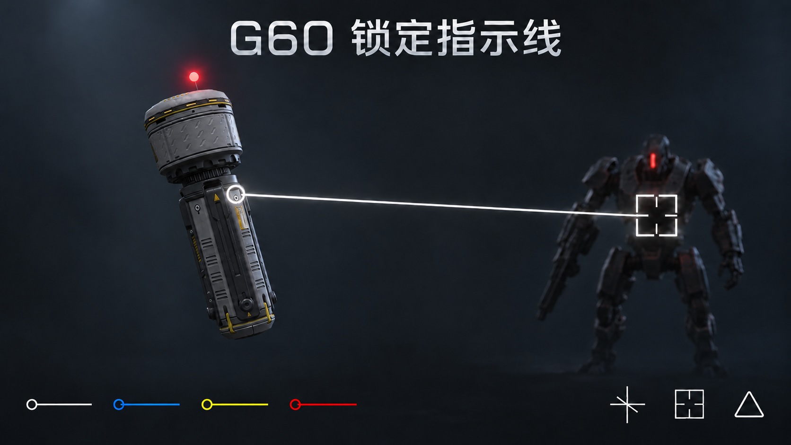

# G60 Lock Line · G60 锁定指示线



为《绝地潜兵 2》的 G60 反坦克寻踪者添加本地位置、目标与状态提示。当前源码版本为 **V1.2.2**。

- 显示当前主视角周围 **80 米**内活跃 G60 的位置圆圈与目标连线。
- 自己的 G60 读取真实锁定目标；队友 G60 根据本机可读取的位置、运动方向和敌军候选持续估算目标。估算准星外侧带圆圈，与真实锁定区分。
- 估算不明确时继续重评候选；新候选稳定约 **0.3 秒**后切换，等待期间保持原连线。候选约 **5 Hz** 采集，终点位置逐帧重新读取和验证。
- 目标样式：**十字 / 十字锁定框 / 飞矛三角标记**。指示颜色：**白 / 蓝 / 黄 / 红**。
- G60 上方 **0.3 米**的白／红光点支持游戏原生 Bloom；自发光强度 32、照明范围 5 米、光点半径约 5 像素。
- 所有显示仅作用于本地，不改动选敌、伤害、导航、飞行行为或网络对象。

没有有效候选、原目标无法验证时，只保留可用的 G60 位置提示；目标死亡、实体失效或 G60 爆炸后清除相应显示。队友目标为本地估算，可能与真实锁定不同。

## 安装

本仓库保存开发源码。构建后的 `release/G60-Lock-Line-V1.2.2.zip` 可导入 Arsenal 或 HD2ModManager；替换旧包后重新部署并完整重启游戏。在管理器中分别选择目标样式、颜色和白／红发光预设。

安装包只包含 40 个必要文件：manifest、游戏补丁及伴随文件、封面和 8 张透明选项预览。源码、开发文档、日志和研究记录不进入安装包；生成的安装包不提交到 Git 历史。

## 开发

需要 Python 3.10+、Pillow 和与 Python 位数一致的 Lua 5.1 动态库。可以使用独立 Lua 5.1 库；若本机游戏目录仍有 `bin/lua51.dll` 也可指定它。游戏安装不保证包含该文件；构建不需要启动游戏，仓库也不附带 DLL。

```powershell
python -m pip install -r requirements.txt
# 自动定位失败时，指定你自己的游戏安装目录：
$env:G60_GAME_DIR = 'C:\path\to\Helldivers 2'
python tools/build.py
```

构建工具自动核对发布白名单与菜单组合。仅需检查修改路径时使用：

```powershell
python tools/check_estimation.py --continuity-only
```

详细构建、检查范围与资源说明见 [开发说明](docs/DEVELOPMENT.md)，模块关系见 [架构说明](docs/ARCHITECTURE.md)，历史变化见 [CHANGELOG](CHANGELOG.md)。

## 兼容与验证状态

兼容指纹固定在 `compat/build.json`，对应开发时研究的 Steam build **25480438**，EXE 指纹前缀 **F5FEE03DCFDB**。初始化会核对完整指纹和布局字节，不匹配即停止。仓库整理没有更新游戏兼容性。

用户已确认 V1.0.0 的基础显示和 V1.2.0 的队友 G60 可见。V1.2.1／V1.2.2 的持续显示和动态估算完成了相应离线检查；尚无这两个版本的游戏内验收记录。无需为了源码整理重复游戏测试。

## English

G60 Lock Line adds local position rings, target lines and reticles to active G60 Seekers within **80 metres of the current camera**. It offers Cross, Cross Lock Frame and Spear Triangle reticles, with white, blue, yellow and red indicator colours. A floating white/red status light supports native bloom.

Your own G60 uses its actual lock data. Teammate targets are continuously estimated from locally available positions, movement and enemy candidates. Estimated reticles have an outer circle. Candidate observations refresh at about 5 Hz; endpoint poses are read each frame. A better candidate must remain preferred for about 0.3 seconds before switching, while the existing line stays visible. Estimates may differ from the actual teammate lock.

This is a source repository. Install Python 3.10+, the pinned Python requirements and a matching Lua 5.1 shared library, then run `python tools/build.py`. If needed, set `G60_GAME_DIR` to your game installation or `G60_LUA_LIBRARY` to a Lua 5.1 library. Import the resulting ZIP from `release/` into your mod manager. Generated packages and private research are excluded from Git.

Compatibility is pinned to the recorded game build, rather than automatically tracking updates. V1.2.2 has offline checks; in-game acceptance of its latest estimation changes is pending. All visuals are local and do not change targeting, damage or flight behaviour.

## 来源与许可 / Attribution

第三方来源、MIT 许可和游戏派生资源的说明见 [THIRD-PARTY-NOTICES.md](THIRD-PARTY-NOTICES.md)。游戏派生的兼容字节与小型材质模板保留原权利归属；仓库不包含游戏可执行文件、DLL、完整提取资源或第三方项目副本。封面为宣传插画，选项预览为示意图。
